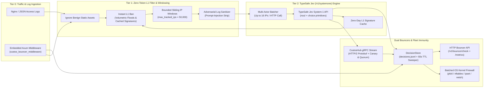

<div align="center">

# 🛡️ Custos (`custos`)

**Autonomous Behavioral Security Engine, Cross-Platform Kernel Firewall Bouncer & gRPC Threat-Intelligence Hub**  
*Powered by [TypeSafe AI's Jev (`/v1/systemone`)](https://typesafe.ai) System-1 Decision Model*

[](https://github.com/george-amir/Custos/actions/workflows/ci.yml)
[](LICENSE)
[](https://www.rust-lang.org)
[](#production-installation--os-firewall-setup)
[](#multi-node-grpc-fleet-sync-custoshub)

[**Quick Start**](#-quick-start) · [**Architecture**](#-architecture) · [**Production Installation**](#-production-installation--os-firewall-setup) · [**Reverse-Proxy Integration**](#-reverse-proxy-bouncer-integration) · [**Rust Library & Axum Middleware**](#-embedding-custos-as-a-rust-library) · [**Configuration Reference**](#️-configuration-reference)

</div>

---

## Overview

**Custos** (*Latin: "The Guardian / Sentinel"*) is a high-performance, single-binary behavioral intrusion prevention system (IPS), application-layer bouncer, and distributed threat-intelligence engine written in Rust.

Inspired by CrowdSec and Fail2Ban, **Custos** replaces brittle regex-maintenance loops with a **3-tier hybrid architecture** that combines deterministic zero-cost L1 filtering, adversarial prompt-injection sanitization, and multi-actor batch reasoning via **TypeSafe AI's Jev (`POST https://api.typesafe.ai/v1/systemone`)** model.

### Why Custos?

| Capability | Traditional Regex WAF / Fail2Ban | Heavy Multi-Daemon IPS | **Custos (`custos`)** |
| :--- | :--- | :--- | :--- |
| **Hot-Path Request Latency** | Inline regex overhead | Out-of-band (Go/Python) | **0 ms** (Out-of-band log tailer) or **< 1 µs** (`DashMap` lookup) |
| **Multi-Step Behavioral Detection** | ❌ Static single-line regex | ⚠️ Manual YAML scenarios | ✅ **Sliding IP behavioral windows + Jev `/v1/systemone` batching** |
| **Prompt-Injection & Evasion Defense** | ❌ Vulnerable to encoding tricks | ❌ None | ✅ **Built-in adversarial log sanitizer + `noul` conviction scoring** |
| **Zero-Day Auto-Signature Promotion** | ❌ Manual rule updates | ❌ Cloud-dependent | ✅ **Promotes high-confidence Jev verdicts into $0 L1 signatures** |
| **OS Kernel Firewall Enforcement** | Linux-only `iptables` | Separate bouncer binaries | ✅ **Built-in batched `nftables`, `ipset`, macOS/BSD `pf`, Windows `netsh`** |
| **Fleet-Wide Threat Sync** | ❌ Local-only | Polling REST APIs | ✅ **Real-time HTTP/2 gRPC streaming (`CustosHub`) with Canary & Quorum guards** |
| **Build & Deployment Footprint** | Python + C dependencies | Multiple daemons + DB | ✅ **Single static Rust binary & zero-`protoc` embeddable crate** |

---

## 🏗️ Architecture



### How the 3-Tier Pipeline Achieves Ultra-Low Cost
1. **95%+ of traffic is filtered at Tier 1 for $0**: Benign `200/304` static asset requests (`.css`, `.js`, `.png`, `.woff2`, `/healthz`), already-banned IPs, and obvious volumetric L1 floods are handled immediately in memory without ever calling an external API.
2. **Multi-Actor Compacted State Batching**: Only suspicious IP behavioral windows (e.g., `401/403` brute-force bursts, `404` path-enumeration spikes, SQLi/XSS/LFI probe tokens, or scanner User-Agents) are promoted to Tier 2. Custos packs up to **16 suspicious actors into a single `/v1/systemone` request** (~$0.00009 per 4-actor batch).
3. **Autonomous L1 Signature Learning**: When Jev convicts an exploit path with high confidence (`confidence >= 0.90`), Custos automatically extracts and normalizes the `(method, path_prefix)` signature into its in-memory L1 cache—blocking all subsequent botnet peers probing the same exploit at **0 tokens and 0 ms**.

---

## 🚀 Quick Start

### 1. Install `custos`

#### From Source (Cargo)
> **Note:** `custos` vendors pre-generated Protobuf/gRPC bindings (`src/hub_proto.rs`), so **no external `protoc` compiler is required**.

```bash
git clone https://github.com/george-amir/Custos.git
cd Custos
cargo install --path .
```

#### Verify Installation with Log Replay
Test the full pipeline offline (`--mock-jev`) or against the live TypeSafe Jev API:

```bash
# Offline deterministic simulation (no API key required)
custos replay --log tests/fixtures/sample_access.log --mock-jev

# Live TypeSafe Jev (/v1/systemone) evaluation
export TYPESAFE_API_KEY="ts_live_..."
custos replay --log tests/fixtures/sample_access.log
```

Preview the batched kernel firewall rules generated across all supported operating systems:
```bash
custos firewall --backend all
```

---

## 🖥️ Production Installation & OS Firewall Setup

In production, `custos` can enforce bans at **Layer 3/4 (OS Kernel Firewall)**, **Layer 7 (Reverse-Proxy HTTP Bouncer)**, or **both simultaneously**.

### 1. Linux Production Setup (`systemd` + `nftables` or `ipset`)

#### Step 1: Install Binary & Configuration
```bash
# Build optimized release binary
cargo build --release
sudo install -m 0755 target/release/custos /usr/local/bin/custos

# Create configuration and state directories
sudo mkdir -p /etc/custos /var/lib/custos
sudo cp config.example.toml /etc/custos/config.toml
```

#### Step 2: Configure Environment & API Key
Create `/etc/custos/custos.env` (permissions `0600`):
```bash
sudo tee /etc/custos/custos.env > /dev/null << 'EOF'
TYPESAFE_API_KEY=ts_live_your_key_here
CUSTOS_API_TOKEN=super_secret_local_admin_token
CUSTOS_HUB_TOKEN=super_secret_fleet_hub_token
RUST_LOG=info
EOF
sudo chmod 0600 /etc/custos/custos.env
```

#### Step 3: Enable `nftables` Kernel Enforcement in `/etc/custos/config.toml`
```toml
[daemon]
bouncer_listen = "127.0.0.1:8085"
decisions_file = "/var/lib/custos/decisions.jsonl"
default_ban_ttl_secs = 3600

[firewall]
enabled = true
backend = "nftables"   # or "ipset" for legacy iptables hosts
dry_run = false        # Enforce live kernel drops
table_name = "custos_block"

[[logs]]
path = "/var/log/nginx/access.log"
format = "nginx_combined"
```

> **How `nftables` works with Custos:** On startup, `custos` automatically initializes the `inet custos_block` table (`block_v4` and `block_v6` sets with native kernel `flags timeout;` and an `input` drop hook at priority `-10`). Batched bans are inserted in a single atomic command (`nft add element inet custos_block block_v4 { 198.51.100.44 timeout 3600s, ... }`), and the Linux kernel automatically expires elements when their TTL elapses.

#### Step 4: Install & Start the Hardened `systemd` Service
```bash
sudo cp deploy/custos.service /etc/systemd/system/custos.service
sudo systemctl daemon-reload
sudo systemctl enable --now custos
sudo systemctl status custos
```

Verify active kernel sets:
```bash
sudo nft list table inet custos_block
```

---

### 2. macOS / FreeBSD / OpenBSD Production Setup (`pf` Packet Filter)

On macOS and BSD systems, `custos` uses the native kernel Packet Filter (`pfctl -t custos_block`) and packs multi-IP bans into a single command (`pfctl -t custos_block -T add <ip1> <ip2> ...`), while its background 60-second TTL sweeper automatically removes expired IPs (`pfctl -t custos_block -T delete <ip>`).

#### Step 1: Add the `custos_block` Table Anchor to `/etc/pf.conf`
Add these two lines to `/etc/pf.conf`:
```pf
table <custos_block> persist
block in quick from <custos_block> to any
```

Reload and enable `pf`:
```bash
sudo pfctl -f /etc/pf.conf
sudo pfctl -e
```

#### Step 2: Run `custos` with Live `pf` Enforcement
```bash
export TYPESAFE_API_KEY="ts_live_..."
sudo -E custos run \
  --log /var/log/nginx/access.log \
  --firewall-backend pf \
  --firewall-live
```

Inspect active kernel-blocked IPs at any time:
```bash
sudo pfctl -t custos_block -T show
```

---

### 3. Windows Server Production Setup (`netsh advfirewall`)

On Windows Server, `custos` automatically selects `windows_netsh` and manages inbound block rules (`name=Custos-Block-<IP>`) via Windows Advanced Firewall, automatically deleting rules when their ban TTL expires.

Run from an Administrator PowerShell prompt:
```powershell
$env:TYPESAFE_API_KEY = "ts_live_..."
custos.exe run --log C:\nginx\logs\access.log --firewall-backend windows_netsh --firewall-live
```

Verify active Windows Firewall rules:
```powershell
netsh advfirewall firewall show rule name=all | Select-String "Custos-Block"
```

---

### 4. Docker & Kubernetes Deployment

Build and run the multi-stage production container (requires `NET_ADMIN` capability and host networking to program the host's `nftables`/`ipset` kernel tables):

```bash
docker build -t custos:latest .

docker run -d \
  --name custos \
  --net=host \
  --cap-add=NET_ADMIN \
  --cap-add=NET_RAW \
  -e TYPESAFE_API_KEY="ts_live_..." \
  -v /var/log/nginx:/var/log/nginx:ro \
  -v custos-data:/var/lib/custos \
  custos:latest
```

---

## 🔌 Reverse-Proxy Bouncer Integration

Even when OS firewall mode is disabled or running in `dry_run = true`, any reverse proxy can query Custos's local HTTP Bouncer API (`GET http://127.0.0.1:8085/v1/bouncer/check`) in **< 1 millisecond**:

- Returns **`200 OK`** (`{"action": "allow"}`) for benign IPs.
- Returns **`403 Forbidden`** (`{"action": "block", "threat_class": "..."}`) with header `X-Custos-Threat: <threat_class>` for banned IPs.

### Nginx (`ngx_http_auth_request_module`)
```nginx
server {
    listen 80;
    server_name example.com;

    # Sub-millisecond Custos Bouncer check before proxying
    auth_request /_custos_check;

    location = /_custos_check {
        internal;
        proxy_pass http://127.0.0.1:8085/v1/bouncer/check;
        proxy_pass_request_body off;
        proxy_set_header Content-Length "";
        proxy_set_header X-Real-IP $remote_addr;
        proxy_set_header X-Forwarded-For $proxy_add_x_forwarded_for;
    }

    location / {
        proxy_pass http://127.0.0.1:3000;
    }
}
```

### Caddy (`forward_auth`)
```caddyfile
example.com {
    forward_auth 127.0.0.1:8085 {
        uri /v1/bouncer/check
        header_up X-Real-IP {remote_host}
    }
    reverse_proxy 127.0.0.1:3000
}
```

### Traefik (`ForwardAuth` Middleware)
```yaml
http:
  middlewares:
    custos-bouncer:
      forwardAuth:
        address: "http://127.0.0.1:8085/v1/bouncer/check"
        trustForwardHeader: true
```

---

## 🌐 Multi-Node gRPC Fleet Sync (`CustosHub`)

When running multiple edge servers (`node-a`, `node-b`, `node-c`), you can run a central **`custos hub`** coordinator over multiplexed HTTP/2 gRPC (`CustosHubService` defined in [`proto/custos_hub.proto`](proto/custos_hub.proto)):

- **Compact Binary Protobuf Wire Format**: IPv4 addresses are transmitted as 4 raw bytes (`bytes ip`) and IPv6 as 16 bytes.
- **Canary Anti-Poisoning Guardrail**: Automatically rejects RFC1918 private networks, loopback, link-local, CGNAT, and critical public DNS/CDN resolvers (`1.1.1.1`, `8.8.8.8`, `9.9.9.9`), plus protected root/auth routes (`/`, `/login`, `/healthz`, `/metrics`) so a misconfigured node can never cause a fleet-wide self-DoS.
- **Multi-Node Quorum Consensus (`--quorum N`)**: Require `N` independent edge nodes to convict an IP or zero-day L1 signature before promoting it to the global monotonic delta stream (`seq`).
- **Single-Command Batched OS Firewall Sync**: Edge nodes receiving a `HubDeltaBatch` apply all newly promoted IPs in a single batched `pfctl` or `nft` kernel call.

```bash
# 1. Start the CustosHub gRPC coordinator (require 2 independent nodes for quorum)
custos hub --listen 0.0.0.0:50051 --quorum 2

# 2. Start edge daemons connected to the bidirectional gRPC stream
custos run --log /var/log/nginx/access.log --hub http://hub.internal:50051 --node-id edge-eu-1
custos run --log /var/log/nginx/access.log --hub http://hub.internal:50051 --node-id edge-us-1

# 3. Or perform a one-shot incremental delta pull & batched firewall sync via cron/systemd timer
custos hub-sync --hub http://hub.internal:50051 --since-seq 0 --firewall-live
```

---

## 🦀 Embedding `custos` as a Rust Library

Because `custos` vendors its generated Protobuf/gRPC code in [`src/hub_proto.rs`](src/hub_proto.rs), you can embed `custos` directly inside any Rust or Axum web service with **zero `protoc` build dependency**.

### Add to `Cargo.toml`
```toml
[dependencies]
custos = { git = "https://github.com/george-amir/Custos.git", tag = "v0.1.0" }
```

### Embed `custos_bouncer_middleware` in an Axum Router
```rust
use axum::{Router, middleware, routing::get};
use custos::SecurityPipeline;
use custos::firewall::FirewallBackend;
use custos::middleware::custos_bouncer_middleware;

#[tokio::main]
async fn main() -> anyhow::Result<()> {
    // 1. Construct the Custos pipeline via the ergonomic builder
    let pipeline = SecurityPipeline::builder()
        .with_decisions_file("decisions.jsonl")
        .with_firewall_backend(FirewallBackend::Auto, true)
        .with_mock_jev(true) // Set false + TYPESAFE_API_KEY in production
        .build()?;

    // 2. Attach the in-process Custos bouncer & behavioral ingestion middleware
    let app: Router = Router::new()
        .route("/api/v1/items", get(|| async { "protected content" }))
        .layer(middleware::from_fn_with_state(
            pipeline,
            custos_bouncer_middleware,
        ));

    drop(app);
    Ok(())
}
```

Run the standalone example:
```bash
cargo run --example axum_embedded
```

---

## 📊 Observability, CLI & Prometheus Metrics

### CLI Operations
```bash
# List active IP bans and their Jev noul conviction scores
custos decisions

# Manually ban or unban an IP address (automatically updates OS firewall)
custos ban 198.51.100.44 --threat manual_block --reason "Emergency block" --ttl-secs 7200
custos unban 198.51.100.44

# Test whether an IP is allowed or blocked
custos check 198.51.100.44

# Inspect JSON telemetry & recent OS firewall commands
custos stats
```

### Prometheus OpenMetrics Endpoint (`GET /metrics`)
Scrape `http://127.0.0.1:8085/metrics` with Prometheus, Grafana Agent, or Vector:

| Metric Name | Type | Description |
| :--- | :--- | :--- |
| `custos_events_processed_total` | `counter` | Total HTTP access log events ingested |
| `custos_static_ignored_total` | `counter` | Benign static asset hits ignored at Tier 1 ($0 cost) |
| `custos_l1_instant_bans_total` | `counter` | Instant bans triggered by L1 flood or cached zero-day signatures |
| `custos_windows_promoted_total` | `counter` | Suspicious IP windows promoted to TypeSafe Jev Tier 2 |
| `custos_jev_batches_total` | `counter` | Total multi-actor batch requests sent to Jev `/v1/systemone` |
| `custos_jev_actors_evaluated_total` | `counter` | Total suspicious actors evaluated by Jev |
| `custos_jev_input_tokens_total` | `counter` | Total Jev input tokens consumed |
| `custos_active_bans` | `gauge` | Current active IP bans in `DecisionStore` |
| `custos_auto_cached_signatures` | `gauge` | Current zero-day L1 signatures cached in memory |
| `custos_firewall_rules_applied_total` | `counter` | Total OS kernel firewall rules applied |
| `custos_firewall_rules_removed_total` | `counter` | Total OS kernel firewall rules removed |
| `custos_firewall_command_errors_total` | `counter` | Total OS firewall command execution errors |

---

## ⚙️ Configuration Reference

See [`config.example.toml`](config.example.toml) for a complete annotated configuration file:

| Section / Key | Default | Environment Override | Description |
| :--- | :--- | :--- | :--- |
| `daemon.bouncer_listen` | `"127.0.0.1:8085"` | — | Local bind address for the HTTP Bouncer & `/metrics` API |
| `daemon.decisions_file` | `"decisions.jsonl"` | — | Append-only JSONL persistence file (auto-compacted every 60s) |
| `daemon.default_ban_ttl_secs` | `3600` | — | Default ban duration in seconds |
| `daemon.api_token` | `""` | `CUSTOS_API_TOKEN` | Optional Bearer token for admin `POST`/`DELETE /v1/decisions` |
| `firewall.enabled` | `true` | — | Enable OS firewall command generation/enforcement |
| `firewall.backend` | `"auto"` | — | `"auto"`, `"pf"`, `"nftables"`, `"ipset"`, or `"windows_netsh"` |
| `firewall.dry_run` | `true` | — | Set `false` (or `--firewall-live`) to execute live kernel rules |
| `firewall.table_name` | `"custos_block"` | — | Kernel table/set name for `pf`, `nftables`, and `ipset` |
| `window.window_secs` | `10` | — | Sliding behavioral window duration per IP |
| `window.flush_interval_ms` | `5000` | — | Interval between multi-actor Jev batch evaluations |
| `window.l1_flood_ban_threshold` | `120` | — | Instant L1 ban threshold (requests per window) |
| `window.max_tracked_ips` | `50000` | — | Maximum concurrent IP windows tracked in RAM (anti-DDoS OOM cap) |
| `jev.endpoint` | `"https://api.typesafe.ai/v1/systemone"` | `TYPESAFE_ENDPOINT` | TypeSafe Jev System-1 API endpoint |
| `jev.api_key` | `""` | `TYPESAFE_API_KEY` | TypeSafe AI Bearer API key |
| `jev.max_actors_per_batch` | `16` | — | Max suspicious actors packed into a single `/v1/systemone` call |
| `jev.noul_ban_threshold` | `0.80` | — | Minimum `noul` conviction probability required to ban an IP |
| `jev.auto_signature_confidence_threshold` | `0.90` | — | Minimum `choice` confidence to promote an attack path to L1 cache |
| `hub.enabled` | `false` | — | Enable gRPC fleet synchronization with a `CustosHub` server |
| `hub.endpoint` | `"http://127.0.0.1:50051"` | — | `CustosHub` gRPC server URL |
| `hub.node_id` | `"custos-node-1"` | — | Unique node identifier for quorum voting |
| `hub.api_token` | `""` | `CUSTOS_HUB_TOKEN` | Shared token for authenticating node signal pushes |

---

## 🧪 Testing & Development

Run the full unit, integration, and doc-test suite (100% pure Rust, no `protoc` or root privileges required):

```bash
cargo test --all-targets
cargo test --doc
cargo clippy --all-targets -- -D warnings
```

---

## 📄 License

Licensed under the [MIT License](LICENSE).
