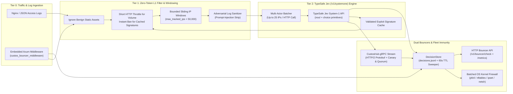

<div align="center">

# 🛡️ Custos (`custos`)

**Autonomous Behavioral Security Engine, Cross-Platform Kernel Firewall Bouncer & gRPC Threat-Intelligence Hub**  
*Powered by [TypeSafe AI's Jev (`/v1/systemone`)](https://typesafe.ai) System-1 Decision Model*

[](https://github.com/george-amir/Custos/releases/latest)
[](https://github.com/george-amir/Custos/actions/workflows/ci.yml)
[](LICENSE)
[](https://www.rust-lang.org)
[](#production-installation--os-firewall-setup)
[](#multi-node-grpc-fleet-sync-custoshub)

[**Quick Start**](#-quick-start) · [**Architecture**](#-architecture) · [**Production Installation**](#-production-installation--os-firewall-setup) · [**Reverse-Proxy Integration**](#-reverse-proxy-bouncer-integration) · [**Rust Library & Axum Middleware**](#-embedding-custos-as-a-rust-library) · [**Configuration Reference**](#️-configuration-reference)

</div>

---

## Overview

**Custos** (*Latin: "The Guardian / Sentinel"*) is a high-performance, single-binary behavioral intrusion prevention system (IPS), application-layer bouncer, and distributed threat-intelligence engine written in Rust.

Inspired by CrowdSec and Fail2Ban, **Custos** replaces brittle regex-maintenance loops with a **3-tier hybrid architecture** that combines deterministic zero-cost L1 filtering, adversarial prompt-injection sanitization, and multi-actor batch reasoning via **TypeSafe AI's Jev (`POST https://api.typesafe.ai/v1/systemone`)** model.

### Why Custos?

| Capability | Traditional Regex WAF / Fail2Ban | Heavy Multi-Daemon IPS | **Custos (`custos`)** |
| :--- | :--- | :--- | :--- |
| **Hot-Path Request Latency** | Inline regex overhead | Out-of-band (Go/Python) | **0 ms** (Out-of-band log tailer) or **< 1 µs** (`DashMap` lookup) |
| **Multi-Step Behavioral Detection** | ❌ Static single-line regex | ⚠️ Manual YAML scenarios | ✅ **Sliding IP behavioral windows + Jev `/v1/systemone` batching** |
| **Prompt-Injection & Evasion Defense** | ❌ Vulnerable to encoding tricks | ❌ None | ✅ **Built-in adversarial log sanitizer + `noul` conviction scoring** |
| **Validated Exploit Signature Learning** | ❌ Manual rule updates | ❌ Cloud-dependent | ✅ **Caches exact known exploit targets from high-confidence verdicts** |
| **OS Kernel Firewall Enforcement** | Linux-only `iptables` | Separate bouncer binaries | ✅ **Built-in batched `nftables`, `ipset`, macOS/BSD `pf`, Windows `netsh`** |
| **Fleet-Wide Threat Sync** | ❌ Local-only | Polling REST APIs | ✅ **Real-time HTTP/2 gRPC streaming (`CustosHub`) with Canary & Quorum guards** |
| **Build & Deployment Footprint** | Python + C dependencies | Multiple daemons + DB | ✅ **Single static Rust binary & zero-`protoc` embeddable crate** |

---

## v0.4.1: Native Traefik / Dokploy JSON access logs

[Download v0.4.1](https://github.com/george-amir/Custos/releases/tag/v0.4.1). The JSON parser now recognizes Traefik's native field names, including `ClientHost` (or `ClientAddr`), `RequestMethod`, `RequestPath`, and `DownstreamStatus`. It preserves the request timestamp with nanosecond precision, using `StartUTC`, then `StartLocal`, then `time`. Client-facing status and bytes are used even when Traefik generates the response itself (`OriginStatus = 0`). Traefik's server-wide `RequestCount` never becomes a per-IP request count.

Use `format = "json"` for Traefik, Caddy, or flat JSON access logs. Live `run --log` now accepts `--format json` (also `--log-format json`); omitting it preserves the Nginx combined default. Unknown format names are rejected instead of silently selecting another parser. See the [Dokploy configuration below](#traefik--dokploy-json-access-logs).

Validation: 153 Rust tests pass, including eight new Traefik regressions for client identity, IPv6, timestamps, proxy-generated responses, request counting, replay, and live ingestion. The original five pasted records parse in isolated mock replay and yield one scanner verdict. Docker validation also generates real Traefik JSON and replays it through the production image with networking and native firewall enforcement disabled.

## v0.4.0: False-positive safeguards and availability at saturation

[Download v0.4.0](https://github.com/george-amir/Custos/releases/tag/v0.4.0) for Linux, macOS, or Windows.

New convictions require deterministic HTTP evidence in addition to the model's probability. Generic resource `401/403` responses, server `5xx` errors, URI punctuation, and request volume cannot independently create Jev IP bans. This rule applies to live and mock analysis; existing, manual, and authenticated Hub bans retain their enforcement behavior.

The five client-traffic cases are handled as follows:

| Case | v0.4.0 behavior |
| :--- | :--- |
| Parallel API calls during token refresh | Resource `401/403` responses remain context; no status-only ban or AI call |
| Repeated requests to one broken URL | Counts distinct paths that actually returned `404`; healthy routes cannot inflate probe diversity |
| Client retry loop / many assets | Default five-second HTTP `429` with `Retry-After`, with no durable/kernel ban or Hub report |
| Several users behind the same public IP | Generic errors cannot combine into a credential ban; shared volume can still briefly throttle that IP |
| Backend errors / encoded JSON query filters | Status and punctuation alone do not promote windows to Jev or authorize a ban |

Credential-failure detection is opt-in through `window.auth_paths`, an exact list of POST login endpoints. The default list is empty. With paths configured, the default threshold is ten failed requests in one window; a successful configured auth request in that collected window suppresses the auth conviction. Endpoint enumeration requires at least five `404`s across four distinct missing paths. Samples now include observed repeat counts such as `[x5]`; sample and path-cardinality storage remain bounded.

**Upgrade:** existing configuration files receive the safer defaults. Set `window.flood_action = "ban"` only to explicitly restore volume-only IP bans. Review real login endpoints before configuring `auth_paths`; Custos cannot observe credentials, verify which account failed, or separate users sharing a public IP. Use application rate limits based on verified accounts/sessions for that distinction. Unverified User-Agent strings and cookies never create independent rate-limit identities. Update Rust struct literals for the new fields, preferably using `..Default::default()`, and handle `L1Disposition::Throttled`.

HTTP throttles use monotonic time, cannot be extended by read-only checks, and survive analysis drains. Their table is capped at the effective window capacity and included in the conservative reservation. At throttle-table capacity, new throttle identities are omitted until expiry frees room; existing throttles and durable bans remain intact. Use frontend rate/concurrency limits for high-cardinality traffic. Log-driven detection follows completed requests, so in-flight requests can pass before the first throttle is recorded; this is not a synchronous admission-rate guarantee.

Validation: 145 Rust tests pass, including all five client scenarios, a local HTTP provider returning maximum-confidence malicious answers for context-only evidence, cooldown expiry, strict-policy opt-in, and bounded missing-path storage. Formatting, Clippy, and Rust 1.88 checks pass. Docker tests exercise the actual Nginx example: healthy requests receive `200`, temporary throttles receive `429` with `Retry-After`, durable bans remain `403`, and original POST signatures survive Nginx's GET auth subrequest.

### Availability at saturation

A full decision ledger now defaults to `daemon.on_decision_capacity = "enforce_existing"`: existing bans and validated cached signatures still reject requests, while unbanned clients remain eligible for admission. New durable bans are refused until cleanup frees slots. Set `"fail_closed"` to retain v0.3.0's strict HTTP 503 policy. Ingestion and HTTP concurrency limits remain independent and can still return overload errors.

Capacity pressure wakes a coalesced background worker, at most once per second, for bounded expiry cleanup. PF/nftables use bulk deletes and ipset uses restore input; Windows uses bounded individual removals. Cleanup is acknowledged with one durable journal sync per group, only after confirmed removal. Both daemon and embedded pipelines also retry durable enforcement in the background; explicit reconciliation processes bounded groups without locking the whole sweep.

The journal now records whether real kernel cleanup is required. Old records conservatively require it. Switching live state to dry-run or disabling the firewall cannot acknowledge its kernel cleanup; startup reports an error if inherited cleanup cannot be performed. Decisions created entirely in HTTP-only/dry-run mode remain reclaimable, and switching them to live enforcement durably marks the obligation before applying a rule. Preserve the journal when changing modes.

Analysis evidence has count/byte limits, a five-minute age limit measured from the latest local observation, fair retries, and a per-flush work budget. Retries cannot extend evidence lifetime. Historical log replay remains supported: log timestamps still define traffic windows, while local monotonic time defines evidence age. Expired or displaced uncommitted evidence is counted; durable bans and cleanup never depend on this queue. A forced flush bypasses retry delays but still respects age and work budgets; repeat it until pending work is drained when replaying large files.

Hub candidate budgets and per-authenticated-reporter quotas prevent one reporter from occupying every pending slot. Unconfirmed votes expire after 60 seconds by default; signatures retain their one-hour promoted lifetime. Existing candidates can complete quorum even at candidate capacity, and active promotions are never evicted for new votes. Total IP/signature bounds remain unchanged.

Sustained validation on macOS (development build, isolated workers):

| Profile | Duration | Attack events | Healthy checks allowed | Peak RSS |
| :--- | ---: | ---: | ---: | ---: |
| Full ledger + failed cleanup + provider outage | 60.1 s | 434,183 | 3,850 / 3,850 | 15.3 MiB |
| Memory saturation, small limits | 60.2 s | 426,000 | — | 16.8 MiB |
| Memory saturation, default limits | 151.2 s | 24,000 | — | 26.4 MiB |

The site profile also passed all 3,850 existing-ban checks and 3,850 signature checks, preserved 32 active bans and 32 failed cleanup obligations across journal reopening, and reclaimed only confirmed cleanup after recovery. Memory profiles also churn a separate HTTP throttle table capped at 120 entries. These profiles use simulated firewall execution and provider failure; they measure retained-state behavior, not native firewall throughput or a universal host memory ceiling. Timings include concurrent local build activity.

Native Linux validation also passed against real nftables and ipset on OrbStack 2.2.5 / Linux 7.2.12. Per backend, 256 expired IPv4/IPv6 entries were cleaned with two unban processes, all 25 healthy checks were allowed at ledger capacity, and an active ban survived restart. Run the repeatable check after building the image:

```sh
docker build -t custos:ci .
python3 .github/scripts/docker-capacity-smoke.py
python3 .github/scripts/docker-proxy-smoke.py
```

**Host kernel prerequisite:** live nftables uses the host/VM kernel. Testing on the older OrbStack 1.9.2 / Linux 6.12.5 ARM64 runtime reproduced an alignment fault in `nft_rhash_gc`, consistent with [CVE-2024-54031](https://security-tracker.debian.org/tracker/CVE-2024-54031). Update to a vendor kernel containing the fix before live timeout testing or enforcement; rebuilding the container does not update that kernel. The native test refuses the known crashing OrbStack kernel release. The same validation passed after the runtime moved to Linux 7.2.12.

## v0.3.0: Memory Limits and Screening Hardening

[Download v0.3.0](https://github.com/george-amir/Custos/releases/tag/v0.3.0) for Linux (x86_64 and ARM64), macOS (Apple Silicon and Intel), or Windows (x86_64).

This release adds bounded ban/cleanup storage, byte-budgeted ingestion, bounded provider responses, and capacity/expiry controls for Hub state and local signatures. Static requests count toward flood limits; windows expire during provider outages; malformed analysis answers are rejected without losing retry work. Screening handles encoded paths and SQL comment separators, redacts known credentials, and retains triggering payload samples. CLI replay streams large logs.

Validation includes 95 passing tests and isolated sustained-load runs: 612,000 simulated requests over 60 seconds with small limits (14.5 MiB peak RSS), and 24,000 over 75 seconds with default limits (31.9 MiB peak RSS). These are memory-saturation profiles, not production throughput or model-accuracy measurements.

### Upgrading from v0.2.x

- **Configuration:** existing TOML files receive defaults for the new `[memory]` section. Review `config.example.toml`; the 64 MiB window reservation budget is separate from queue, ban, and Hub limits and is not a process RSS ceiling.
- **Overload in v0.3.0:** existing bans and cleanup obligations are preserved; unknown clients receive HTTP 503 at decision capacity. v0.4.0 introduces the configurable availability policy above. Include static assets when sizing the flood threshold.
- **Persistence:** the journal must fit the configured decision capacity; reasons are limited to 512 bytes, threat names to 64 bytes, and journal records to 4 KiB. Startup rejects incompatible records explicitly. Preserve cleanup obligations when migrating or changing limits.
- **Embedded Rust applications:** update explicit `AppConfig`/`WindowConfig` struct literals for the new fields or use `..Default::default()`. Handle overload errors from `submit_event`; use `spawn_pipeline_tailer` for byte-budgeted file ingestion or `visit_log_file` for streaming replay. The bulk `replay_log_file` helper collects caller-owned events.
- **Hub deployments:** upgrade Hub and nodes together to use capacity acknowledgements and retries. The wire protocol adds `PushAck.rejected_capacity` and `rejected_invalid`; requests are limited to 256 signals and 256 KiB. Vote/signature retention, per-entry voter limits, and subscription limits now apply.
- **Source builds:** Rust 1.88 or newer is required. `custos --version` should report `custos 0.3.0`.


---

## 🏗️ Architecture



### How the 3-Tier Pipeline Achieves Ultra-Low Cost
1. **Benign static traffic is filtered at Tier 1 for $0**: Successful `GET`/`HEAD` static asset requests with no suspicious URI or User-Agent signals skip AI analysis, while still counting toward L1 flood limits. Set the flood threshold for total page traffic, including assets. Cached exploit signatures are checked before this shortcut.
2. **Multi-Actor Compacted State Batching**: Suspicious IP windows containing configured login failures without recovery, diverse missing-path probes, SQLi/XSS/LFI tokens, or scanner signals are promoted to Tier 2. Generic errors and punctuation alone stay out of analysis. Custos packs up to **25 suspicious actors into a single `/v1/systemone` request** (~$0.00009 per 4-actor batch).
3. **Conservative L1 Signature Learning**: High-confidence actor verdicts can cache exact known exploit targets such as `/.env` and `/.git/config`. Ordinary application routes, first samples without exploit evidence, and query-specific attacks never become route-wide signatures. Cached matches avoid additional AI calls.

Window expiration runs during ingestion even while Jev is unavailable. Failed analysis batches remain available for retry; expired suspicious windows use a bounded backlog. If that backlog fills, the oldest expired evidence is dropped and counted in `custos_expired_evidence_dropped_total`.

HTTP inspection decodes at most two percent-encoding layers and recognizes SQL comment/whitespace separators. Samples retain the highest-risk requests, including an excerpt around late attack indicators. Known credential parameters and Bearer/Basic values are redacted before samples are stored or sent to Jev. Missing answers, invalid classes, and out-of-range probabilities fail analysis and retain the batch for retry.

Input limits are 64 KiB per log record, 8 KiB for the inspected path/query, 1 KiB for User-Agent, and 32 bytes for the method. Oversized HTTP fields are truncated before queuing and marked for analysis; oversized log records are discarded through their newline. Per-window samples are capped at 32 and distinct-path fingerprints at 1,024, including when larger counts are configured. `window.max_state_bytes` reserves space conservatively for active and expired windows and may reduce capacity below `max_tracked_ips`; it is not a total process memory limit. The minimum reservation is one active/expired window pair.

Behavioral analysis evaluates access-log metadata after a request completes. Embedded middleware can reject existing IP bans and validated cached signatures before the handler; standalone signature checks require original request metadata from the trusted proxy. Bodies, cookies, raw protocol headers, and application authorization context are not inspected. Use application authorization and an upstream WAF for controls that must reject an initial exploit request.

---

### Memory admission under sustained load

`window.max_state_bytes` bounds window reservations. The `[memory]` settings separately bound retained bans/cleanup, ingestion, provider responses, and Hub state. They do not impose a total process RSS ceiling.

- Active bans and pending firewall cleanup share `max_decisions` slots (10,000 by default). New bans fail at capacity; existing bans and cleanup obligations are preserved. The default `enforce_existing` policy keeps unbanned clients eligible for HTTP admission; `fail_closed` returns `503` at decision capacity. Existing IP bans and cached signatures still block. Cleanup frees slots only after confirmed removal and durable acknowledgment; native timeout alone never discards an obligation. Ban reasons are limited to 512 bytes and threat names to 64 bytes. Loading a journal that exceeds capacity or contains an oversized record fails explicitly; size limits apply during replay before parsing.
- Ingestion reserves 12 KiB per queued/running event or outstanding HTTP permit against an 8 MiB default budget, with at most 1,024 channel slots. Public `submit_event` returns an overload error rather than accumulating waiting producers. CLI replay streams records through `visit_log_file` instead of collecting the log. The explicit bulk `replay_log_file` helper returns a caller-owned vector and scales with file size. File readers backpressure directly into this queue; the daemon has no intermediate event queue and supports at most 16 log sources. Reader batches target 64 KiB, plus at most one record. The legacy `spawn_log_tailer` API uses a caller-owned channel; size that channel explicitly or prefer `spawn_pipeline_tailer`.
- Jev response bodies, including HTTP error bodies and chunked responses, stop at 256 KiB by default. Batches contain at most 64 actors. Invalid or oversized replies retain evidence for fair, bounded retries. Pending work is capped at 4,096 actors and 16 MiB of conservative evidence/verdict reservations. The five-minute monotonic age limit starts at the latest local observation, including time waiting in windows; retries never reset it. Each flush attempts at most 16 batches. Retries isolate individual actors to keep a malformed actor from poisoning its former batch mates. Concurrent flushes return a busy error instead of accumulating waiters; cancellation cannot accumulate detached enforcement jobs.
- Hub IP votes/promotions share 10,000 slots; signatures share 1,024 slots. At most 2,500 IP candidates and 256 signature candidates can be pending, within the existing total bounds. Per reporter, pending votes are capped at the smaller of 1,000 and half the relevant candidate budget (rounded up); completing quorum bypasses that reporter quota. Votes below quorum expire after 60 seconds or `hub_retention_secs`, whichever is shorter. Promoted signatures retain their one-hour lifetime; promoted IPs keep their explicit expiry. Each entry has at most 64 voters, node identities are bounded, and signature targets are limited to 256 bytes. `PushAck.rejected_capacity` and `rejected_invalid` report refusals. The reconnecting client retains capacity-rejected batches for retry. Existing live deltas remain available to slow subscribers; history is bounded by live state.
- Hub wire messages are limited to 256 KiB inbound and 4 MiB outbound. There are at most 16 intel subscriptions with a one-message buffer each; the HTTP bouncer API admits at most 16 response bodies at once. Saturated clients receive explicit overload errors. Local signature caches also have capacity and expiry limits.

An existing journal must fit the configured decision and record limits before startup. Preserve the journal and its cleanup obligations when changing limits; a smaller limit does not silently discard records. Set a service/container memory limit and web-server connection/request limits for host isolation; application handlers, caller-owned data, networking, and allocator overhead are outside these retained-state budgets.

The isolated stress test runs automatically with the regression suite. For longer runs:

```sh
CUSTOS_STRESS_SECONDS=60 cargo test --test ddos_stress -- --nocapture
CUSTOS_STRESS_DEFAULTS=1 CUSTOS_STRESS_SECONDS=60 cargo test --test ddos_stress sustained_ddos_memory_plateaus -- --nocapture
```

It simulates distinct attacking IPs, long URLs and headers, ban saturation, signature churn, Hub quorum/expiry, queue pressure, and failed analysis retries. It asserts per-component admission limits, Rust heap stability after warm-up, and process resident-memory high-water bounds. A separate saturation worker combines concurrent attack producers, a full ledger, failed kernel cleanup, a provider outage, and noisy Hub reporting. It continuously checks healthy HTTP admission, existing bans and signatures, then reopens the journal and verifies cleanup recovery. Firewall operations in these profiles use an injected kernel model; native command builders and partial failures have separate regression coverage. These are repeatable load profiles, not a universal memory ceiling for every deployment.


## 🚀 Quick Start

### 1. One-Line Install (Linux & macOS)

```bash
curl -fsSL https://raw.githubusercontent.com/george-amir/Custos/main/install.sh | sh
```

#### Or Install Directly via Cargo (No `protoc` Required)
```bash
cargo install --git https://github.com/george-amir/Custos.git --tag v0.4.1 --locked
```

### 2. Zero-Config Setup & Run (`custos init`)

`custos init` automatically detects your operating system's native kernel firewall (`pf`, `nftables`, `ipset`, or `windows_netsh`), scans standard web-server paths for existing Nginx/Caddy/Apache access logs, and writes a ready-to-run `config.toml`:

```bash
# 1. Auto-detect OS firewall + web server logs and generate config.toml
custos init

# 2. Set your TypeSafe Jev API key (or omit to run in local simulation mode)
export TYPESAFE_API_KEY="ts_live_..."

# 3. Start the Custos daemon (or simply run `custos` with no arguments!)
custos
```

### 3. Verify Installation with Log Replay
Test the full pipeline on the included attack fixture:

```bash
# Offline deterministic simulation (no API key required)
custos replay --log tests/fixtures/sample_access.log --mock-jev

# Live TypeSafe Jev (/v1/systemone) evaluation
export TYPESAFE_API_KEY="ts_live_..."
custos replay --log tests/fixtures/sample_access.log

# Preview batched kernel firewall rules across Linux, macOS/BSD, and Windows
custos firewall --backend all
```

---

## 🖥️ Production Installation & OS Firewall Setup

In production, `custos` can enforce bans at **Layer 3/4 (OS Kernel Firewall)**, **Layer 7 (Reverse-Proxy HTTP Bouncer)**, or **both simultaneously**.

### ⚡ One-Command Background Service Setup (Linux, macOS & Windows)

`custos` includes a built-in cross-platform service manager (`custos service`) that automatically configures `/etc/custos/config.toml`, discovers your web server logs, sets up your native OS service (`systemd` on Linux, `launchd` on macOS, or Windows Service Control Manager on Windows), and starts the daemon in the background:

```bash
# Preview the generated systemd unit / macOS launchd plist / Windows service command
custos service install --dry-run

# Install & start Custos as a persistent background OS service with live kernel firewall enforcement
export TYPESAFE_API_KEY="ts_live_..."
sudo -E custos service install --firewall-live

# Manage the running service at any time
sudo custos service status
sudo custos service stop
sudo custos service start
sudo custos service uninstall
```

---

### 1. Manual Linux Production Setup (`systemd` + `nftables` or `ipset`)

#### Step 1: Install Binary & Configuration
```bash
# Build optimized release binary
cargo build --release
sudo install -m 0755 target/release/custos /usr/local/bin/custos

# Create configuration and state directories
sudo mkdir -p /etc/custos /var/lib/custos
sudo cp config.example.toml /etc/custos/config.toml
```

#### Step 2: Configure Environment & API Key
Create `/etc/custos/custos.env` (permissions `0600`):
```bash
sudo tee /etc/custos/custos.env > /dev/null << 'EOF'
TYPESAFE_API_KEY=ts_live_your_key_here
CUSTOS_API_TOKEN=super_secret_local_admin_token
CUSTOS_HUB_TOKEN=super_secret_fleet_hub_token
RUST_LOG=info
EOF
sudo chmod 0600 /etc/custos/custos.env
```

#### Step 3: Enable `nftables` Kernel Enforcement in `/etc/custos/config.toml`
```toml
[daemon]
bouncer_listen = "127.0.0.1:8085"
decisions_file = "/var/lib/custos/decisions.jsonl"
default_ban_ttl_secs = 3600

[firewall]
enabled = true
backend = "nftables"   # or "ipset" for legacy iptables hosts
dry_run = false        # Enforce live kernel drops
table_name = "custos_block"

[[logs]]
path = "/var/log/nginx/access.log"
format = "nginx_combined"
```

> **How `nftables` works with Custos:** On startup, `custos` automatically initializes the `inet custos_block` table (`block_v4` and `block_v6` sets with native kernel `flags timeout;` and an `input` drop hook at priority `-10`). Batched bans are inserted in a single atomic command (`nft add element inet custos_block block_v4 { 198.51.100.44 timeout 3600s, ... }`), and the Linux kernel automatically expires elements when their TTL elapses.

#### Step 4: Install & Start the Hardened `systemd` Service
```bash
sudo cp deploy/custos.service /etc/systemd/system/custos.service
sudo systemctl daemon-reload
sudo systemctl enable --now custos
sudo systemctl status custos
```

Verify active kernel sets:
```bash
sudo nft list table inet custos_block
```

---

### 2. macOS / FreeBSD / OpenBSD Production Setup (`pf` Packet Filter)

On macOS and BSD systems, `custos` uses the native kernel Packet Filter (`pfctl -t custos_block`) and packs multi-IP bans into a single command (`pfctl -t custos_block -T add <ip1> <ip2> ...`), while its background 60-second TTL sweeper automatically removes expired IPs (`pfctl -t custos_block -T delete <ip>`).

#### Step 1: Add the `custos_block` Table Anchor to `/etc/pf.conf`
Add these two lines to `/etc/pf.conf`:
```pf
table <custos_block> persist
block in quick from <custos_block> to any
```

Reload and enable `pf`:
```bash
sudo pfctl -f /etc/pf.conf
sudo pfctl -e
```

#### Step 2: Run `custos` with Live `pf` Enforcement
```bash
export TYPESAFE_API_KEY="ts_live_..."
sudo -E custos run \
  --log /var/log/nginx/access.log \
  --firewall-backend pf \
  --firewall-live
```

Inspect active kernel-blocked IPs at any time:
```bash
sudo pfctl -t custos_block -T show
```

---

### 3. Windows Server Production Setup (`netsh advfirewall`)

On Windows Server, `custos` automatically selects `windows_netsh` and manages inbound block rules (`name=Custos-Block-<IP>`) via Windows Advanced Firewall, automatically deleting rules when their ban TTL expires.

Run from an Administrator PowerShell prompt:
```powershell
$env:TYPESAFE_API_KEY = "ts_live_..."
custos.exe run --log C:\nginx\logs\access.log --firewall-backend windows_netsh --firewall-live
```

Verify active Windows Firewall rules:
```powershell
netsh advfirewall firewall show rule name=all | Select-String "Custos-Block"
```

---

### 4. Docker & Kubernetes Deployment

Build and run the multi-stage production container (requires `NET_ADMIN` capability and host networking to program the host's `nftables`/`ipset` kernel tables):

```bash
docker build -t custos:latest .

docker run -d \
  --name custos \
  --net=host \
  --cap-add=NET_ADMIN \
  --cap-add=NET_RAW \
  -e TYPESAFE_API_KEY="ts_live_..." \
  -v /var/log/nginx:/var/log/nginx:ro \
  -v custos-data:/var/lib/custos \
  custos:latest
```

---

## 🔌 Reverse-Proxy Bouncer Integration

Even when OS firewall mode is disabled or running in `dry_run = true`, any reverse proxy can query Custos's local HTTP Bouncer API (`GET http://127.0.0.1:8085/v1/bouncer/check`) in **< 1 millisecond**:

- Returns **`200 OK`** (`{"action": "allow"}`) for benign IPs.
- Returns **`403 Forbidden`** (`{"action": "block", "threat_class": "..."}`) with header `X-Custos-Threat: <threat_class>` for banned IPs.
- Returns **`429 Too Many Requests`** (`{"action": "throttle"}`), `Retry-After`, and `X-Custos-Action: throttle` for temporary volume limits. Checks do not extend the cooldown.

To reject cached signatures through the standalone checker, the proxy must overwrite both `X-Original-Method` and `X-Original-URI` with the protected request's values. Missing both preserves IP-only checks; incomplete/invalid metadata returns `400`. Trusted headers take precedence over optional `method`/`uri` query parameters. Keep this API reachable only by trusted proxies. The examples below follow [Nginx auth subrequests](https://nginx.org/en/docs/http/ngx_http_auth_request_module.html) and [Caddy's original-request forwarding](https://caddyserver.com/docs/caddyfile/directives/forward_auth).

### Nginx (`ngx_http_auth_request_module`)

Nginx auth subrequests accept only `2xx`, `401`, or `403`. Use `auth_request=true` so Custos represents a temporary throttle as `403` with an action header; the configuration below maps only that action back to client-facing `429`. Existing bans remain `403`.

```nginx
server {
    listen 80;
    server_name example.com;

    auth_request_set $custos_action $upstream_http_x_custos_action;
    auth_request_set $custos_retry_after $upstream_http_retry_after;
    error_page 403 = @custos_denied;

    location @custos_denied {
        add_header Retry-After $custos_retry_after always;
        if ($custos_action = throttle) { return 429; }
        return 403;
    }

    location = /_custos_check {
        internal;
        proxy_pass http://127.0.0.1:8085/v1/bouncer/check?auth_request=true&ip=$remote_addr;
        proxy_pass_request_body off;
        proxy_set_header Content-Length "";
        proxy_set_header X-Real-IP $remote_addr;
        proxy_set_header X-Original-Method $custos_original_method;
        proxy_set_header X-Original-URI $request_uri;
        proxy_set_header X-Forwarded-For $proxy_add_x_forwarded_for;
    }

    location / {
        # Capture the parent method before Nginx creates its GET auth subrequest.
        set $custos_original_method $request_method;
        auth_request /_custos_check;
        proxy_pass http://127.0.0.1:3000;
    }
}
```

### Caddy (`forward_auth`)
```caddyfile
example.com {
    forward_auth 127.0.0.1:8085 {
        uri /v1/bouncer/check
        header_up X-Real-IP {remote_host}
        header_up X-Original-Method {method}
        header_up X-Original-URI {uri}
    }
    reverse_proxy 127.0.0.1:3000
}
```

### Traefik (`ForwardAuth` Middleware)
```yaml
http:
  middlewares:
    custos-bouncer:
      forwardAuth:
        address: "http://127.0.0.1:8085/v1/bouncer/check"
        trustForwardHeader: true
```

### Traefik / Dokploy JSON Access Logs

Set the access-log source explicitly in the Custos configuration (replace an existing entry for the same file rather than adding a duplicate):

```toml
[[logs]]
path = "/etc/dokploy/traefik/dynamic/access.log"
format = "json"
```

Restart the existing Custos daemon after updating its binary and configuration. For a manual run, choose one source configuration:

```sh
# Use the [[logs]] entries from your configuration:
sudo custos --config /etc/custos/config.toml run

# Or supply an additional JSON log explicitly:
sudo custos run --log /etc/dokploy/traefik/dynamic/access.log --format json
```

Normal daemon startup reads new records from the end of the file. `--from-start` includes existing records. Replay accepts the same JSON schema:

```sh
custos --config test-config.toml replay --log /path/to/traefik-access.jsonl --format json --mock-jev
```

For an isolated replay, use a test configuration with `firewall.enabled = false`, a separate `daemon.decisions_file`, and Hub synchronization disabled. Replay evaluates historical records; it is not a read-only parser command.

The parser uses the logged client address, never `RequestHost`, `ServiceAddr`, or a raw forwarded header. Keep `ClientHost` or `ClientAddr`, `RequestMethod`, `RequestPath`, and `DownstreamStatus` in the [Traefik JSON access log](https://doc.traefik.io/traefik/v3.5/reference/install-configuration/observability/logs-and-accesslogs/#json-format-fields). `request_User-Agent` and `request_Referer` are optional; other logged headers are ignored. If Custos runs in a container, mount the log's parent directory read-only and configure its path inside that container so file rotation remains visible.

Traefik's TLS/ACME diagnostic messages from `docker logs dokploy-traefik` are separate from HTTP access records and are not ingested as HTTP traffic.

---

## 🌐 Multi-Node gRPC Fleet Sync (`CustosHub`)

When running multiple edge servers (`node-a`, `node-b`, `node-c`), you can run a central **`custos hub`** coordinator over multiplexed HTTP/2 gRPC (`CustosHubService` defined in [`proto/custos_hub.proto`](proto/custos_hub.proto)):

- **Compact Binary Protobuf Wire Format**: IPv4 addresses are transmitted as 4 raw bytes (`bytes ip`) and IPv6 as 16 bytes.
- **Canary Anti-Poisoning Guardrail**: Automatically rejects RFC1918 private networks, loopback, link-local, CGNAT, and critical public DNS/CDN resolvers (`1.1.1.1`, `8.8.8.8`, `9.9.9.9`), plus protected root/auth routes (`/`, `/login`, `/healthz`, `/metrics`) so a misconfigured node can never cause a fleet-wide self-DoS.
- **Multi-Node Quorum Consensus (`--quorum N`)**: Require `N` independent edge nodes to convict an IP or zero-day L1 signature before promoting it to the global monotonic delta stream (`seq`).
- **Single-Command Batched OS Firewall Sync**: Edge nodes receiving a `HubDeltaBatch` apply all newly promoted IPs in a single batched `pfctl` or `nft` kernel call.

```bash
# 1. Start the CustosHub gRPC coordinator (require 2 independent nodes for quorum)
custos --config hub.toml hub --listen 0.0.0.0:50051 --quorum 2

# 2. Start edge daemons connected to the bidirectional gRPC stream
CUSTOS_HUB_TOKEN="replace-with-eu-secret" custos run --log /var/log/nginx/access.log --hub http://hub.internal:50051 --node-id edge-eu-1
CUSTOS_HUB_TOKEN="replace-with-us-secret" custos run --log /var/log/nginx/access.log --hub http://hub.internal:50051 --node-id edge-us-1

# 3. Or perform a one-shot incremental delta pull & batched firewall sync via cron/systemd timer
CUSTOS_HUB_TOKEN="replace-with-eu-secret" custos --config edge-eu.toml hub-sync --hub http://hub.internal:50051 --since-seq 0 --firewall-live
```

Create a private `hub.toml` with independent credentials:

```toml
[hub.node_tokens]
edge-eu-1 = "replace-with-eu-secret"
edge-us-1 = "replace-with-us-secret"
```

Each edge's `hub.node_id` must match its credential entry. A shared `hub.api_token` is supported for a trusted fleet but represents only one quorum voter. The Hub refuses to start without credentials; all RPCs require authentication. Protect credentials in transit using a private encrypted network or a TLS-terminating proxy.

Upgrade Hub and nodes together: IP deltas now carry absolute expiry, and clients ignore legacy deltas without it. Reconnection retrieves current active intelligence and retries unacknowledged reports. Expired bans are not renewed by replay.

---

## 🦀 Embedding `custos` as a Rust Library

Because `custos` vendors its generated Protobuf/gRPC code in [`src/hub_proto.rs`](src/hub_proto.rs), you can embed `custos` directly inside any Rust or Axum web service with **zero `protoc` build dependency**.

### Add to `Cargo.toml`
```toml
[dependencies]
custos = { git = "https://github.com/george-amir/Custos.git", tag = "v0.4.1" }
```

### Embed `custos_bouncer_middleware` in an Axum Router
```rust
use axum::{Router, middleware, routing::get};
use custos::SecurityPipeline;
use custos::firewall::FirewallBackend;
use custos::middleware::custos_bouncer_middleware;

#[tokio::main]
async fn main() -> anyhow::Result<()> {
    // 1. Construct the Custos pipeline via the ergonomic builder
    let pipeline = SecurityPipeline::builder()
        .with_decisions_file("decisions.jsonl")
        .with_firewall_backend(FirewallBackend::Auto, true)
        .with_mock_jev(true) // Set false + TYPESAFE_API_KEY in production
        .build()?;

    // 2. Attach the in-process Custos bouncer & behavioral ingestion middleware
    let app: Router = Router::new()
        .route("/api/v1/items", get(|| async { "protected content" }))
        .layer(middleware::from_fn_with_state(
            pipeline,
            custos_bouncer_middleware,
        ));

    let listener = tokio::net::TcpListener::bind("127.0.0.1:3000").await?;
    axum::serve(listener, app.into_make_service_with_connect_info::<std::net::SocketAddr>()).await?;
    Ok(())
}
```

The middleware requires `ConnectInfo<SocketAddr>` and uses the real socket peer by default. Set `daemon.trusted_proxies` through `with_config` only for proxies that overwrite forwarding headers. Missing connection identity returns 400. Ingestion uses a bounded worker queue; saturation returns 503 before running the application handler.

`SecurityPipeline::new` now returns `Result`; startup enforcement errors must be handled. `AppState` takes `{ pipeline, api_token }`, and `DecisionStore::remove_ban` returns `Result<bool>`. Embedded applications should periodically call `reconcile_firewall` on a blocking worker to retry enforcement and remove expired kernel rules, alongside periodic `flush_and_analyze`. Forced flushes wait for previously queued events.

Run the standalone example:
```bash
cargo run --example axum_embedded
```

---

## 📊 Observability, CLI & Prometheus Metrics

### CLI Operations
```bash
# List active IP bans and their Jev noul conviction scores
custos decisions

# Configure the same admin token in the daemon and CLI environment
export CUSTOS_API_TOKEN="replace-with-your-admin-secret"

# Manually ban or unban an IP address (automatically updates OS firewall)
custos ban 198.51.100.44 --threat manual_block --reason "Emergency block" --ttl-secs 7200
custos unban 198.51.100.44

# Test whether an IP is allowed or blocked
custos check 198.51.100.44

# Inspect JSON telemetry & recent OS firewall commands
custos stats
```

### Prometheus OpenMetrics Endpoint (`GET /metrics`)
Scrape `http://127.0.0.1:8085/metrics` with Prometheus, Grafana Agent, or Vector:

| Metric Name | Type | Description |
| :--- | :--- | :--- |
| `custos_events_processed_total` | `counter` | Total HTTP access log events ingested |
| `custos_static_ignored_total` | `counter` | Static hits skipped for AI analysis while counting toward flood limits |
| `custos_capacity_dropped_total` | `counter` | Events rejected because active window capacity was reached |
| `custos_expired_evidence_dropped_total` | `counter` | Oldest expired windows dropped when the evidence backlog filled |
| `custos_l1_instant_bans_total` | `counter` | Cached-signature bans or explicitly opted-in strict volume bans |
| `custos_http_throttles_total` / `custos_http_throttles_retained` | `counter` / `gauge` | Short HTTP-only limits created / bounded retained entries, including entries awaiting an expiry sweep |
| `custos_jev_evidence_rejected_total` | `counter` | Model convictions rejected because deterministic evidence did not support the class |
| `custos_windows_promoted_total` | `counter` | Suspicious IP windows promoted to TypeSafe Jev Tier 2 |
| `custos_jev_batches_total` | `counter` | Total multi-actor batch requests sent to Jev `/v1/systemone` |
| `custos_jev_actors_evaluated_total` | `counter` | Total suspicious actors evaluated by Jev |
| `custos_jev_input_tokens_total` | `counter` | Total Jev input tokens consumed |
| `custos_active_bans` | `gauge` | Current active IP bans in `DecisionStore` |
| `custos_decision_retained` / `custos_decision_cleanup_pending` | `gauge` | Total retained slots / cleanup obligations |
| `custos_decision_saturated` | `gauge` | 1 while the retained decision ledger is full |
| `custos_decision_capacity_rejected_total` | `counter` | Actual new-ban admission refusals |
| `custos_decision_capacity_allowed_total` / `custos_decision_capacity_blocked_total` | `counter` | Admissions allowed/refused by the saturated decision policy |
| `custos_analysis_pending_actors` / `custos_analysis_pending_bytes` | `gauge` | Pending analysis count / reserved bytes |
| `custos_analysis_expired_total` / `custos_analysis_capacity_dropped_total` | `counter` | Uncommitted evidence expired / displaced at capacity |
| `custos_analysis_retried_total` | `counter` | Actor retries scheduled |
| `custos_auto_cached_signatures` | `gauge` | Current zero-day L1 signatures cached in memory |
| `custos_firewall_rules_applied_total` | `counter` | Total OS kernel firewall rules applied |
| `custos_firewall_rules_removed_total` | `counter` | Total OS kernel firewall rules removed |
| `custos_firewall_command_errors_total` | `counter` | Total OS firewall command execution errors |

---

## ⚙️ Configuration Reference

See [`config.example.toml`](config.example.toml) for a complete annotated configuration file:

| Section / Key | Default | Environment Override | Description |
| :--- | :--- | :--- | :--- |
| `daemon.bouncer_listen` | `"127.0.0.1:8085"` | — | Local bind address for the HTTP Bouncer & `/metrics` API |
| `daemon.decisions_file` | `"decisions.jsonl"` | — | Append-only JSONL persistence file (auto-compacted every 60s) |
| `daemon.default_ban_ttl_secs` | `3600` | — | Default ban duration in seconds |
| `daemon.on_decision_capacity` | `"enforce_existing"` | — | Allow unbanned HTTP clients at ledger capacity, or select `"fail_closed"` |
| `daemon.trusted_proxies` | `[]` | — | Exact trusted proxy socket IPs for embedded middleware |
| `daemon.api_token` | `""` | `CUSTOS_API_TOKEN` | Required Bearer token for admin mutations; empty disables mutations |
| `firewall.enabled` | `true` | — | Enable OS firewall command generation/enforcement |
| `firewall.backend` | `"auto"` | — | `"auto"`, `"pf"`, `"nftables"`, `"ipset"`, or `"windows_netsh"` |
| `firewall.dry_run` | `true` | — | Set `false` (or `--firewall-live`) to execute live kernel rules; Docker configuration uses `false` |
| `firewall.table_name` | `"custos_block"` | — | Kernel table/set name for `pf`, `nftables`, and `ipset` |
| `window.window_secs` | `15` | — | Sliding behavioral window duration per IP |
| `window.flush_interval_ms` | `2500` | — | Interval between multi-actor Jev batch evaluations |
| `window.l1_flood_threshold` | `120` | — | Total requests per IP window before a volume action, including static assets |
| `window.flood_action` | `"throttle"` | — | Short HTTP-only throttle; `"ban"` opts into volume-only durable IP bans |
| `window.throttle_secs` | `5` | — | HTTP cooldown, 1–60 seconds |
| `window.auth_paths` | `[]` | — | Exact POST login paths eligible for credential-failure evidence; empty disables status-only auth bans |
| `window.auth_failure_threshold` | `10` | — | Failed configured auth requests required, minimum 3; success suppresses auth conviction for that collected window |
| `window.max_tracked_ips` | `50000` | — | Upper bound on active IP windows, also limited by the state reservation budget |
| `window.max_state_bytes` | `67108864` | — | Conservative reservation budget for active and expired window evidence (64 MiB) |
| `memory.max_decisions` | `10000` | — | Combined retained ban and cleanup slots |
| `memory.event_queue_bytes` | `8388608` | — | Ingestion reservation budget (8 MiB) |
| `memory.event_queue_capacity` | `1024` | — | Maximum ingestion channel slots |
| `memory.max_provider_response_bytes` | `262144` | — | Maximum Jev response body (256 KiB) |
| `memory.hub_max_entries` | `10000` | — | Hub IP vote and promotion slots |
| `memory.max_signatures` | `1024` | — | Hub and local cache signature slots |
| `memory.hub_retention_secs` | `3600` | — | Promoted signature retention and upper bound on unconfirmed vote retention |
| `memory.hub_max_streams` | `16` | — | Simultaneous Hub intel subscriptions |
| `memory.max_pending_actors` | `4096` | — | Maximum retained analysis actors |
| `memory.max_pending_bytes` | `16777216` | — | Conservative pending evidence and cached-verdict reservations |
| `memory.analysis_ttl_secs` | `300` | — | Evidence age from latest local observation; range 1–86400 |
| `memory.analysis_retry_secs` | `1` | — | Initial retry delay; exponential backoff caps at 60 seconds |
| `memory.analysis_batches_per_flush` | `16` | — | Maximum analysis/apply batches attempted per flush |
| `memory.hub_max_pending_entries` | `2500` | — | Pending IP candidate cap within `hub_max_entries` |
| `memory.hub_max_pending_signatures` | `256` | — | Pending signature candidate cap within `max_signatures` |
| `memory.hub_max_pending_per_node` | `1000` | — | Reporter quota, additionally capped at half the candidate budget |
| `memory.hub_vote_ttl_secs` | `60` | — | Unconfirmed vote TTL, also capped by `hub_retention_secs` |
| `jev.endpoint` | `"https://api.typesafe.ai/v1/systemone"` | — | TypeSafe Jev System-1 API endpoint |
| `jev.api_key` | `""` | `TYPESAFE_API_KEY` | TypeSafe AI Bearer API key |
| `jev.max_actors_per_batch` | `25` | — | Max suspicious actors packed into a single `/v1/systemone` call |
| `jev.noul_ban_threshold` | `0.80` | — | Minimum `noul` conviction probability required to ban an IP |
| `jev.auto_signature_confidence_threshold` | `0.92` | — | Minimum `choice` confidence to promote an attack path to L1 cache |
| `hub.enabled` | `false` | — | Enable gRPC fleet synchronization with a `CustosHub` server |
| `hub.endpoint` | `"http://127.0.0.1:50051"` | — | `CustosHub` gRPC server URL |
| `hub.node_id` | `"custos-node-1"` | — | Node identifier matching a server credential entry |
| `hub.node_tokens` | `{}` | — | Hub-side map of independent node IDs to distinct secrets |
| `hub.api_token` | `""` | `CUSTOS_HUB_TOKEN` | Node credential; shared server token counts as one voter |

---

## 🧪 Testing & Development

Run the unit, integration, and doc-test suite (no `protoc` or root privileges required; transport regressions bind temporary localhost ports):

```bash
cargo test --all-targets
cargo test --doc
cargo clippy --all-targets -- -D warnings
cargo fmt --all -- --check
```

Regression suites cover authentication, signature poisoning, bounded memory, concurrent journal writes, cleanup/retry, batch failures, log rotation and partial records, Hub cursors/expiry/reconnection, private credentials, and deployment contracts. CI additionally builds the Docker image, checks enforcement in an isolated container network namespace, and starts/stops an ephemeral Windows SCM service.

---

## 📄 License

Licensed under the [MIT License](LICENSE).
